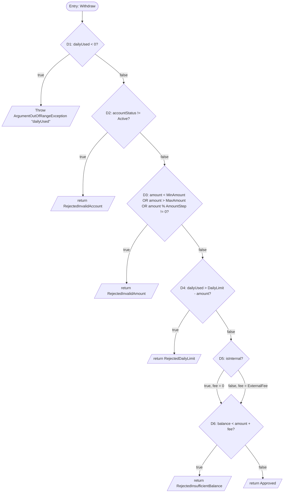
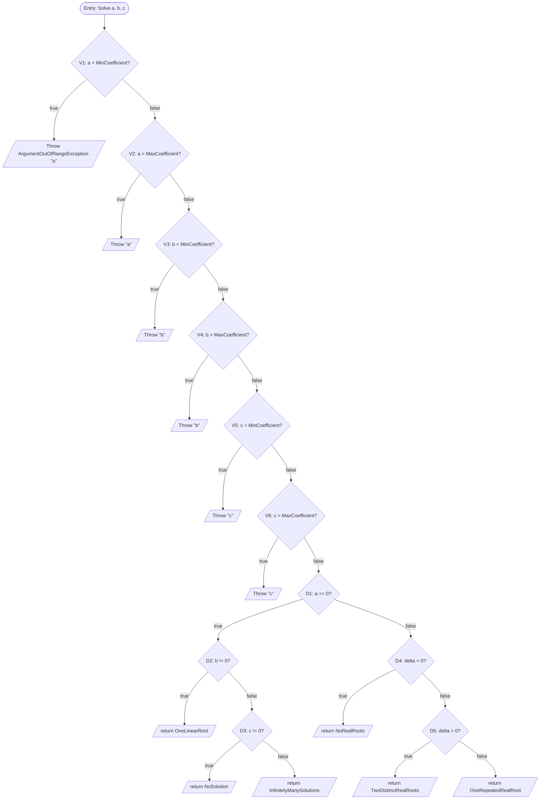

# Control-Flow-Based Tests (CFT)

Systematic tests for `AtmService.Withdraw` and `QuadraticSolver.Solve`, derived from each method's control flow
graph (CFG) rather than from arbitrary examples. Test code:
`tests/SoftwareTesting.Atm.Tests/White/AtmControlFlowTests.cs`,
`tests/SoftwareTesting.Quadratic.Tests/White/QuadraticControlFlowTests.cs`.

Constants (from production code, not invented):

| Constant | Value | Constant | Value |
| --- | --- | --- | --- |
| `MinAmount` | 50,000 | `MinCoefficient` | -100 |
| `MaxAmount` | 20,000,000 | `MaxCoefficient` | 100 |
| `AmountStep` | 50,000 | `DailyLimit` | 20,000,000 |
| `ExternalFee` | 50,000 | | |

---

## CFG-ATM: `AtmService.Withdraw(balance, dailyUsed, amount, accountStatus, isInternal)`



Node numbering in execution order: D1 (guard) → D2 (R1 status) → D3 (R2 range/granularity) → D4 (R3 daily
limit) → D5 (R4 fee) → D6 (R5 balance). D1 is the guard of the XML doc comment and runs before R1.

### Feasible paths and symbolic input conditions

Each path lists the True/False outcome of every decision it meets, combined with logical AND. Later
conditions include the negation of earlier ones needed to reach them.

| Path | Decision outcomes | Symbolic input conditions | Concrete witness (balance, dailyUsed, amount, status, isInternal) | Expected |
| --- | --- | --- | --- | --- |
| P1 | D1=T | `dailyUsed < 0` | (1,000,000, -1, 500,000, Active, true) | throws `ArgumentOutOfRangeException` ("dailyUsed") |
| P2 | D1=F, D2=T | `dailyUsed >= 0 ∧ accountStatus != Active` | (1,000,000, 0, 500,000, Frozen, true) | `RejectedInvalidAccount` |
| P3a | D1=F, D2=F, D3=T (1st disjunct) | `dailyUsed >= 0 ∧ status = Active ∧ amount < MinAmount` | (25,000,000, 0, 25,000, Active, true) | `RejectedInvalidAmount` |
| P3b | D1=F, D2=F, D3=T (2nd disjunct) | `... ∧ amount >= MinAmount ∧ amount > MaxAmount` | (25,000,000, 0, 30,000,000, Active, true) | `RejectedInvalidAmount` |
| P3c | D1=F, D2=F, D3=T (3rd disjunct) | `... ∧ MinAmount <= amount <= MaxAmount ∧ amount % AmountStep != 0` | (25,000,000, 0, 512,345, Active, true) | `RejectedInvalidAmount` |
| P4 | D1=F, D2=F, D3=F, D4=T | `... ∧ dailyUsed > DailyLimit - amount` | (25,000,000, 19,750,000, 500,000, Active, true) | `RejectedDailyLimit` |
| P5 | D1=F..D4=F, D5=T, D6=T | `... ∧ isInternal ∧ balance < amount` | (100,000, 0, 500,000, Active, true) | `RejectedInsufficientBalance` |
| P6 | D1=F..D4=F, D5=T, D6=F | `... ∧ isInternal ∧ balance >= amount` | (25,000,000, 0, 500,000, Active, true) | `Approved` |
| P7 | D1=F..D4=F, D5=F, D6=T | `... ∧ !isInternal ∧ balance < amount + ExternalFee` | (100,000, 0, 500,000, Active, false) | `RejectedInsufficientBalance` |
| P8 | D1=F..D4=F, D5=F, D6=F | `... ∧ !isInternal ∧ balance >= amount + ExternalFee` | (25,000,000, 0, 500,000, Active, false) | `Approved` |

All eight paths are feasible. P3 is split into three cases because the R2 predicate is a short-circuit
disjunction: each operand is a separate branch, and branch coverage requires a case where operand 1 is
true, a case where operand 1 is false and operand 2 is true, a case where operands 1-2 are false and
operand 3 is true, and a case where all three are false (covered by P4-P8). D5 (the `isInternal` ternary)
does not select an exit by itself but is a branch: its true arm is covered by P5/P6 and its false arm
by P7/P8. A path is not a test case: P2, for example, also has a second witness with an undefined status
byte `(AccountStatus)99`, and P1 has witnesses with `long.MinValue` and with `Frozen` status (the guard
precedes R1, so it throws regardless).

Infeasible combinations (documented, not tested as impossible paths): none among the enumerated paths.
The decision-table work (`AtmDecisionTableTests`) notes that amount classes A1/A3/A4 make the daily-sum
condition vacuous because R2 already rejected the amount; those are still single paths (P3a/P3b/P3c).

---

## CFG-QE: `QuadraticSolver.Solve(a, b, c)`



The six coefficient validations run in the fixed short-circuit order V1-V6 (`a<min, a>max, b<min, b>max,
c<min, c>max`). Each validation path's witness violates exactly one bound, so the first encountered failing
validation is the one asserted. `delta = (long)b * b - 4L * a * c` is computed in 64-bit (see
`QuadraticSolver.Discriminant`).

### Feasible paths and symbolic input conditions

| Path | Decision outcomes | Symbolic input conditions | Concrete witness (a, b, c) | Expected |
| --- | --- | --- | --- | --- |
| QP1 | V1=T | `a < -100` | (-101, 0, 0) | throws `ArgumentOutOfRangeException` ("a") |
| QP2 | V1=F, V2=T | `a >= -100 ∧ a > 100` | (101, 0, 0) | throws ("a") |
| QP3 | V1=F, V2=F, V3=T | `-100 <= a <= 100 ∧ b < -100` | (0, -101, 0) | throws ("b") |
| QP4 | V1=F..V3=F, V4=T | `-100 <= a <= 100 ∧ -100 <= b <= 100` is implied by V3=F ∧ `b > 100` | (0, 101, 0) | throws ("b") |
| QP5 | V1=F..V4=F, V5=T | `a, b in range ∧ c < -100` | (0, 0, -101) | throws ("c") |
| QP6 | V1=F..V5=F, V6=T | `a, b in range ∧ c > 100` | (0, 0, 101) | throws ("c") |
| QP7 | V1=F..V6=F, D1=T, D2=T | `a, b, c in range ∧ a == 0 ∧ b != 0` | (0, 2, -4) | `OneLinearRoot` |
| QP8 | V1=F..V6=F, D1=T, D2=F, D3=T | `... ∧ a == 0 ∧ b == 0 ∧ c != 0` | (0, 0, 5) | `NoSolution` |
| QP9 | V1=F..V6=F, D1=T, D2=F, D3=F | `... ∧ a == 0 ∧ b == 0 ∧ c == 0` | (0, 0, 0) | `InfinitelyManySolutions` |
| QP10 | V1=F..V6=F, D1=F, D4=T | `... ∧ a != 0 ∧ delta < 0` | (1, 1, 10), delta = 1-40 = -39 | `NoRealRoots` |
| QP11 | V1=F..V6=F, D1=F, D4=F, D5=T | `... ∧ a != 0 ∧ delta > 0` | (1, 7, 6), delta = 49-24 = 25 | `TwoDistinctRealRoots` |
| QP12 | V1=F..V6=F, D1=F, D4=F, D5=F | `... ∧ a != 0 ∧ delta == 0` | (1, 2, 1), delta = 4-4 = 0 | `OneRepeatedRealRoot` |

All twelve paths are feasible. The six validation paths throw the same exception type but are distinct
branches (distinct `ParamName` and distinct validation statements) and are kept separate, as required.

Infeasible boundary values (documented, not tested as impossible cases): for integer coefficients,
`delta = b^2 - 4ac ≡ 0 or 1 (mod 4)` because `b^2 mod 4 ∈ {0, 1}` and `4ac ≡ 0 (mod 4)`. Hence
`delta ∈ {-1, -2, 2, 3}` is unreachable; the exhaustive sweep (`QuadraticExhaustiveTests`) confirms the
counts for `delta = -2, -1, 2, 3` over `[-100, 100]^3` are exactly 0. The reachable discriminant edges are
therefore -4, -3, 0, 1, 4 (boundary tests B7-B11).

---

## Boundary companions

Kept distinct from the path cases above (the task treats path coverage and boundary-value analysis as
separate layers):

- ATM `AtmControlFlowBoundaryTests` B1-B12: amount Min/Max and their ±1 neighbours, the off-lattice
  Min+1, the daily-sum equality edge (`dailyUsed + amount = DailyLimit` passes, +1 fails), the internal
  and external balance equality edges (`balance = amount` and `balance = amount + ExternalFee` pass, -1
  fails), and the `dailyUsed = 0` guard edge.
- Quadratic `QuadraticControlFlowBoundaryTests` B1-B11: `MinCoefficient`/`MaxCoefficient` for each of a, b, c
  (all allowed, none throws), and the reachable discriminant edges -4, -3, 0, 1, 4 with the
  `Discriminant` value asserted alongside the classification.

## Coverage

Collected with Coverlet through its native Microsoft.Testing.Platform integration (`coverlet.MTP` 10.1.0 in
both test csprojs, opt-in via the `--coverlet` flag), Cobertura format, after a full green suite run:

```
dotnet test tests/SoftwareTesting.Atm.Tests       -c Release --coverlet --coverlet-output-format cobertura --results-directory TestResults/Coverage/Atm
dotnet test tests/SoftwareTesting.Quadratic.Tests -c Release --coverlet --coverlet-output-format cobertura --results-directory TestResults/Coverage/Quadratic
```

The VSTest-collector form (`coverlet.collector` + `--collect:"XPlat Code Coverage"`) does not work in this
solution: the test projects run on MTP (`xunit.v3.mtp-v2`), where that collector is never loaded. One csproj
detail matters: the `coverlet.MTP` reference needs `IncludeAssets` containing `compile`, because MTP's build
step generates `SelfRegisteredExtensions.cs` with a static call to `Coverlet.MTP.TestingPlatformBuilderHook`
(the `PrivateAssets` template that omits `compile` produces CS0400).

Runs: ATM 155/155 passed, Quadratic 134/134 passed. Reports are timestamped
(`TestResults/Coverage/<Project>/coverage.cobertura.<utc-stamp>.xml`, gitignored). An HTML report over both
runs is in `TestResults/Coverage/Html/index.html`, generated with ReportGenerator 5.5.11
(`dotnet-reportgenerator-globaltool`, installed to a temp tool path outside the repo — no repo tool manifest
change):

```
reportgenerator -reports:"TestResults\Coverage\Atm\*.xml;TestResults\Coverage\Quadratic\*.xml" -targetdir:"TestResults\Coverage\Html" -reporttypes:Html
```

### Target methods (measured)

| Method | Lines | Branches (conditions) |
| --- | --- | --- |
| `AtmService.Withdraw` (ATM run) | 9/9 = **100%** | 7/7 = **100%** |
| `QuadraticSolver.Solve` incl. `Discriminant` (Quadratic run) | 17/17 = **100%** | 5/5 = **100%** |

Every line of both production files executes, and every branch condition the compiler emits in these
files takes both outcomes. Mapping of the conditions to the CFGs above:

- `Withdraw` — 7 conditions: D2 (line 28), D3's short-circuit disjunction (line 32: three conditions, one
  per operand — true side by P3a/P3b/P3c, false side by P4–P8), D4 (line 37), D5's fee ternary (line 41,
  true arm by P5/P6, false arm by P7/P8), D6 (line 42).
- `Solve` — 5 conditions: D1 (line 32), D2 (line 34), D3 (line 36), D4 (line 42), D5 (line 44).

Two decision points carry no branch condition in these assemblies because the conditional lives inside
framework code, which Coverlet does not instrument; at the call site they are plain calls:

- Guard D1: `ArgumentOutOfRangeException.ThrowIfNegative` (AtmService line 25).
- Validations V1–V6: `ThrowIfLessThan` / `ThrowIfGreaterThan` (QuadraticSolver lines 25–30).

Both outcomes are still exercised — P1 asserts the guard throws while every other ATM test passes it, and
QP1–QP6 assert exactly one throwing input per validation while all other Quadratic tests pass all six — but
the report cannot display them as branches. Tooling boundary, not a test gap.

### Uncovered branches in the reports (outside the methods under test)

Report roots read ATM 19/19 lines, 16/18 branches (88.9%) and Quadratic 27/27 lines, 12/14 branches (85.7%).
Both branch deficits are the same two conditions in shared test-support code `tests/SoftwareTesting.Tests/PaperLayers.cs`,
each at 50%; both target classes themselves are 100%:

- Line 11, `Environment.GetEnvironmentVariable("SWT_LAYERS")?.Split(...)`: the runs leave `SWT_LAYERS`
  unset, so only the null arm executes.
- Line 16, `Selected is null || Selected.Contains(layer)`: `Selected` is a process-wide static, so a run
  either always short-circuits (variable unset) or never does (set) — never both sides in one process.

A single test run can therefore never mark either condition covered: per-process static state plus
Coverlet's single-run model. These are neither missing tests nor infeasible paths of `Withdraw`/`Solve` —
the lines are 100% executed and the conditions belong to the layer-ablation filter, not to the methods
under test. Setting `SWT_LAYERS` (e.g. the documented `L1,L2` form) for a run flips each condition to its
other 50% side; it still cannot yield 100% in a single run.
